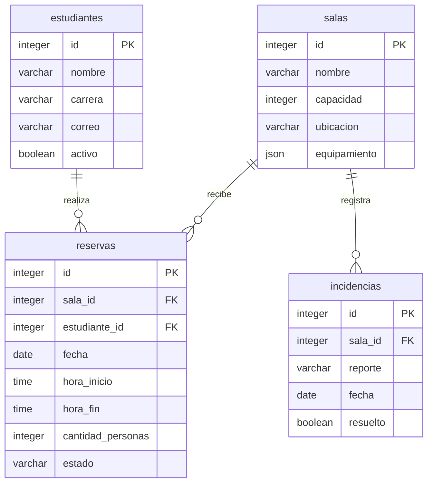

# Modelo de datos PostgreSQL

Este esquema corresponde a los modelos de `infrastructure/models/` y a la migración `migrations/versions/0001_crear_tablas.py`. Los endpoints usan estas tablas mediante repositorios SQLAlchemy y sesiones por solicitud.

- Todas las tablas tienen un ID entero generado por la base y columnas obligatorias (`NOT NULL`).
- Sala tiene nombre de hasta 80 caracteres, ubicación de hasta 120 y equipamiento como lista JSON.
- Estudiante tiene nombre y carrera de hasta 80 caracteres y correo de hasta 254. No se añade una restricción de correo único porque el contrato actual permite repetirlo.
- Reserva utiliza fechas y horas sin zona horaria; `estado` se guarda como texto de hasta 9 caracteres. Pydantic restringe sus valores a `activa` y `cancelada`.
- Incidencia tiene un reporte de hasta 500 caracteres y una referencia obligatoria a la sala.
- Las tres claves foráneas tienen índices. Impiden guardar referencias inexistentes y eliminar registros padres mientras tengan referencias; no se borra información relacionada en cascada.
- Las validaciones de entrada siguen en Pydantic y las reglas de capacidad, horarios, superposición y límite diario siguen en los servicios. Las FK refuerzan la integridad de las relaciones en la base.

## Preparación y reversión

Ejecuta `python -m alembic upgrade head` para crear las tablas. El comando usa las variables DB_* de `.env`, sin guardar credenciales en `alembic.ini`. Las tablas se crean mediante migración, nunca al arrancar la API.

En una base desechable de pruebas, `python -m alembic downgrade base` revierte la migración y elimina las cuatro tablas y sus datos. No ejecutar sobre una base con datos que quieras conservar. Después puede repetirse `upgrade head`.

El ciclo completo se verificó en PostgreSQL mediante `tests_manual/verificar_postgres.py`: migraciones, 63 casos de API, persistencia tras reiniciar y dos reservas simultáneas. Los seeders se ejecutan con `python -m infrastructure.seeders.run` y solo cargan si las cuatro tablas están vacías. Pendiente: trasladar filtros/orden/paginación al repositorio SQL.
