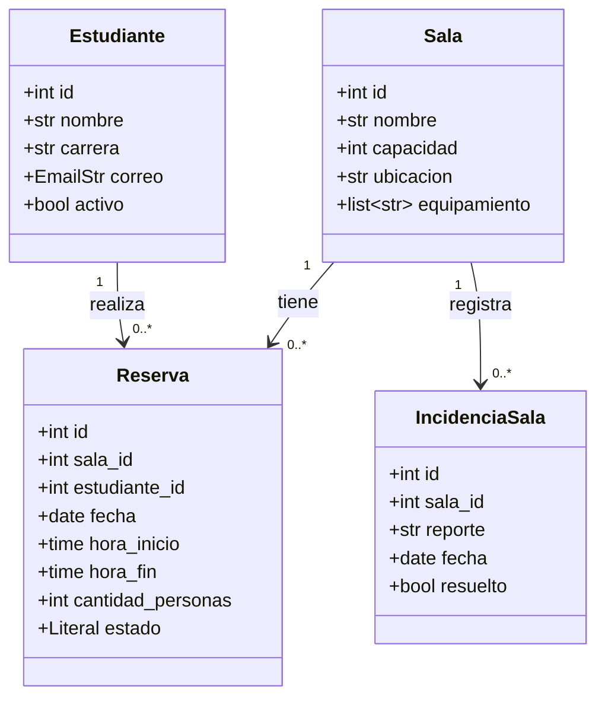

# Modelo de dominio: reservas de salas de estudio

El sistema contiene **cuatro entidades** y **tres relaciones uno a muchos**. El diagrama representa sus atributos actuales, contrastados con los modelos Pydantic del proyecto. Cada entidad tiene un ID y al menos cuatro atributos adicionales.

`estado` es un `Literal` con los valores `activa` y `cancelada`. `EmailStr` valida el formato del correo; `date` y `time` representan fechas y horas. Las horas de reserva se expresan sin zona horaria, como hora local del campus.

## Cómo leer las relaciones

| Relación | Significado | Referencia utilizada |
|---|---|---|
| Sala 1 → 0..* Reserva | Una sala puede no tener reservas o tener varias. Cada reserva pertenece a una sola sala. | `Reserva.sala_id` |
| Estudiante 1 → 0..* Reserva | Un estudiante puede no tener reservas o tener varias. Cada reserva pertenece a un solo estudiante. | `Reserva.estudiante_id` |
| Sala 1 → 0..* IncidenciaSala | Una sala puede no tener incidencias o tener varias. Cada incidencia corresponde a una sola sala. | `IncidenciaSala.sala_id` |

Los números indican multiplicidad: `1` significa exactamente uno y `0..*` significa cero o muchos. El límite de dos reservas activas por estudiante y fecha es una regla de negocio; no elimina la relación uno a muchos porque un estudiante puede acumular reservas en fechas diferentes.

## Correspondencia con el código

Las entidades independientes ya existen como dataclasses en `domain/`: `Sala`, `Estudiante`, `Reserva` e `IncidenciaSala`. No dependen de Pydantic ni de SQLAlchemy. Los DTO están en `presentation/schemas/dtos/`; los modelos de tablas están en `infrastructure/models/` y los mappers en `infrastructure/mappers/`.

En este bloque, las entidades de dominio y los modelos ORM todavía no están conectados a los servicios activos. La API sigue almacenando modelos Pydantic de respuesta en los diccionarios de `app/repositories/`. Las reglas permanecen en `application/services/`; la conexión con repositorios SQL se hará en el siguiente bloque.

Los DTO de creación no reciben el ID. En las entidades de dominio, `id=None` representa un registro nuevo, antes de persistir. `IncidenciaSalaActualizar` sigue permitiendo cambiar únicamente `resuelto`.

Las relaciones de las nuevas tablas están documentadas en [modelo-datos.md](modelo-datos.md). En la API activa todavía son referencias entre registros en memoria, verificadas por los servicios.

## Reglas vinculadas al modelo

- `Reserva.hora_fin` debe ser posterior a `hora_inicio`.
- Dos reservas activas de una misma sala y fecha no pueden tener horarios superpuestos. Los horarios contiguos sí se permiten.
- Un estudiante puede tener como máximo dos reservas activas durante una misma fecha.
- `Reserva.cantidad_personas` no puede superar `Sala.capacidad`.
- Reducir la capacidad de una sala no puede dejar reservas activas con más personas que la nueva capacidad.

Las reglas anteriores se implementan en los servicios; Pydantic se ocupa de tipos, formatos y restricciones de campos. Los estados `Estudiante.activo` e `IncidenciaSala.resuelto` se almacenan, pero actualmente no bloquean reservas ni modifican la disponibilidad de una sala.
