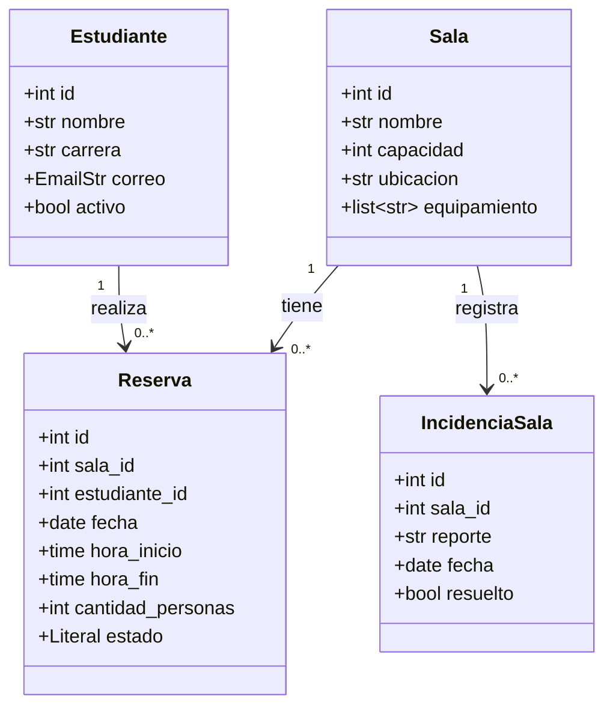

# Modelo de dominio: reservas de salas de estudio

El sistema contiene **cuatro entidades** y **tres relaciones uno a muchos**. El diagrama representa sus atributos actuales, contrastados con los modelos Pydantic del proyecto. Cada entidad tiene un ID y al menos cuatro atributos adicionales.

`estado` es un `Literal` con los valores `activa` y `cancelada`. `EmailStr` valida el formato del correo; `date` y `time` representan fechas y horas. Las horas de reserva se expresan sin zona horaria, como hora local del campus.

## Cómo leer las relaciones

| Relación | Significado | Referencia utilizada |
|---|---|---|
| Sala 1 → 0..* Reserva | Una sala puede no tener reservas o tener varias. Cada reserva pertenece a una sola sala. | `Reserva.sala_id` |
| Estudiante 1 → 0..* Reserva | Un estudiante puede no tener reservas o tener varias. Cada reserva pertenece a un solo estudiante. | `Reserva.estudiante_id` |
| Sala 1 → 0..* IncidenciaSala | Una sala puede no tener incidencias o tener varias. Cada incidencia corresponde a una sola sala. | `IncidenciaSala.sala_id` |

Los números indican multiplicidad: `1` significa exactamente uno y `0..*` significa cero o muchos. El límite de dos reservas activas por estudiante y fecha es una regla de negocio; no elimina la relación uno a muchos porque un estudiante puede acumular reservas en fechas diferentes.

## Correspondencia con el código

Los nombres del diagrama describen las entidades del problema. En esta implementación, sus registros se representan mediante modelos Pydantic de respuesta y se almacenan en diccionarios. No existen clases separadas llamadas `Sala`, `Estudiante`, `Reserva` o `IncidenciaSala` dentro de `app/domain/`.

| Entidad | Modelo de registro | Archivo del modelo | Repositorio |
|---|---|---|---|
| Sala | `SalaRespuesta` | [sala.py](../app/schemas/sala.py) | [sala_repository.py](../app/repositories/sala_repository.py) |
| Estudiante | `EstudianteRespuesta` | [estudiante.py](../app/schemas/estudiante.py) | [estudiante_repository.py](../app/repositories/estudiante_repository.py) |
| Reserva | `ReservaRespuesta` | [reserva.py](../app/schemas/reserva.py) | [reserva_repository.py](../app/repositories/reserva_repository.py) |
| IncidenciaSala | `IncidenciaSalaRespuesta` | [incidencia_sala.py](../app/schemas/incidencia_sala.py) | [incidencia_repository.py](../app/repositories/incidencia_repository.py) |

Los DTO de creación no reciben el ID: lo genera el repositorio. Los DTO de actualización describen los campos editables. En particular, `IncidenciaSalaActualizar` solo permite cambiar `resuelto`, conservando los demás atributos.

Los IDs relacionados son referencias entre registros en memoria; no son claves foráneas de una base de datos. Los servicios comprueban que la sala y el estudiante existan antes de crear o actualizar una reserva, y que la sala exista al registrar una incidencia. Al reiniciar la aplicación se pierden los registros.

## Reglas vinculadas al modelo

- `Reserva.hora_fin` debe ser posterior a `hora_inicio`.
- Dos reservas activas de una misma sala y fecha no pueden tener horarios superpuestos. Los horarios contiguos sí se permiten.
- Un estudiante puede tener como máximo dos reservas activas durante una misma fecha.
- `Reserva.cantidad_personas` no puede superar `Sala.capacidad`.
- Reducir la capacidad de una sala no puede dejar reservas activas con más personas que la nueva capacidad.

Las reglas anteriores se implementan en los servicios; Pydantic se ocupa de tipos, formatos y restricciones de campos. Los estados `Estudiante.activo` e `IncidenciaSala.resuelto` se almacenan, pero actualmente no bloquean reservas ni modifican la disponibilidad de una sala.
